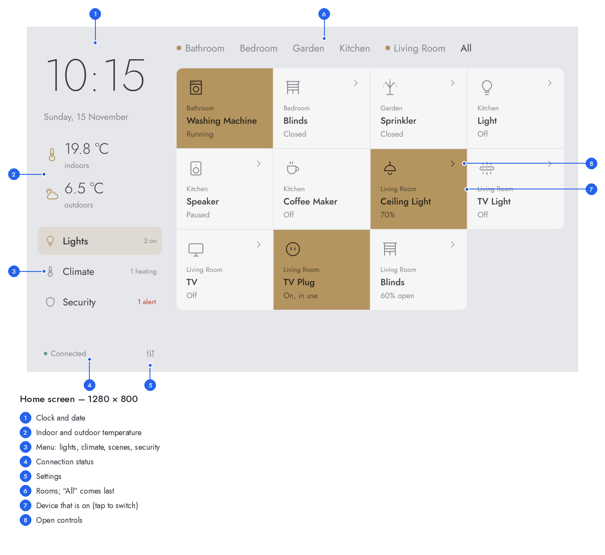

# Homebridge Panel

Touch app for the Raspberry Pi (Linux) to control lights, smart plugs and heating through
**Homebridge** using the **HomeKit Accessory Protocol (HAP)**. The UI is built with Qt Quick
(QML), the logic in Python with **PySide6**.

**Works with Homebridge 1.x and 2.x.**



**[Project page →](https://marcjohnce.github.io/homebridge-panel/)** · **[User interface guide with annotated screenshots for all screen sizes →](docs/user-interface.md)**

```
┌──────────────────────────── Raspberry Pi ────────────────────────────┐
│  Qt UI (QML)  ◄──── signals / properties ────┐                        │
│   home screen · detail views · settings       │                        │
│                                               │                        │
│  Controller (app/qt)  ──── background thread (asyncio) ────┐           │
│                             DeviceManager                  │           │
│                             backends: HAP · Homebridge UI · demo       │
└────────────────────────────────────────────────────────────┼───────────┘
                                                             ▼
                                         Homebridge (HAP, port 51826 …)
```

## Features

- **Lights**: on/off, brightness bar, color wheel, white tone
- **Smart plugs / switches**: on/off, "in use" indicator; kinds plug, switch, coffee machine, washing
  machine, dishwasher, fan, 3D printer, computer; plugs that measure power can be set to "only measure"
  (never switched by the panel, e.g. a fridge or a server)
- **Heating**: thermostats and heater-coolers with a dial (drag or −/+), modes Off/Heat/Auto
- **Fans**: on/off, speed
- **Blinds**: open, close, stop, position by dragging, slat angle; smooth position updates while moving
- **Sensors**: temperature, humidity, air pressure (Eve), light level, air quality, CO₂, fine dust (PM2.5/PM10)
  and VOC; bad air or high CO₂ shown in red; sensors of one device
  combined into one tile; outdoor sensors shown as outdoor temperature
- **History**: charts of temperature, humidity, air pressure and the power draw of plugs over the last 24 hours, 7 or 30 days for devices with an Eve history;
  an opening log of windows, doors and garage doors for the last 30 days
- **Power measuring plugs** (Eve characteristics): power on the tile, power now and total consumption in kWh
  (plugins built on fakegato-history or homebridge-lib), read over HAP
- **Security**: window, door, glass break, leak, motion, presence, smoke and CO sensors; open windows and alarms
  first, a leak, glass break, smoke or CO alarm wakes the panel and shows a message
- **Favorites** as the start page: devices from every room on one page, in your own order
- **Weather** from Open-Meteo (no account needed) for one or more places, found by name or given as
  coordinates: the weather now and the next 7 days, one tab per place; the default place on the screen saver
- **Menu** Favorites, Lights, Scenes, Climate, Weather, Energy (devices that measure their power, total power in the menu; a smart meter or main meter over Homebridge or MQTT replaces the sum), Security; room tabs per menu entry with "All" last; a dot
  marks rooms with lights on (Lights) or an open window or alarm (Security)
- **Gestures**: swipe left/right to change rooms or, in the detail view, devices; swipe in from the left
  edge to go back; two fingers down switch the lights of the room off (with Undo); hold and drag on a tile to dim a light
  or move a blind; pull down at the top to read every device again now; a double tap on the screen saver runs a chosen scene
- **MQTT**: virtual devices show values of MQTT topics (e.g. boiler pressure in bar), broker set up in the settings
- **Light groups**: several lights of a room as one tile
- **Alarm system**: arm (Home, Away, Night) and disarm a HomeKit security system, optionally with a PIN;
  motion sensors only count while it is armed; single sensors can be kept out of the alerts
- **Batteries**: a red battery on the tile when a device's battery is below 10 % or reported low;
  *Settings → Batteries* lists all battery devices
- **Motorized windows and doors**: position, open/stop/close; open ones count as alerts
- **Speakers / smart speakers**: volume, mute, play/pause/stop
- **Air purifiers** (auto/manual, speed) and **humidifiers / dehumidifiers** (mode, target humidity, water level)
- **Televisions**: on/off, input sources, volume, mute and remote keys
- **Door locks**: state, unlocked as alert, lock/unlock after a confirmation (unlocking with the alarm PIN)
- **Garage doors**: state, open door as alert, open/close after a confirmation (opening with the alarm PIN)
- **Valves**: irrigation, shower, faucet and generic valves; open/close, remaining time, run time
- **Switch groups**: several switches of a room of which only one is on (e.g. irrigation circuits); a tap
  switches to the next one
- **Rooms** managed on the panel: add, rename, reorder and delete rooms, sort and move devices,
  change display names; optionally hide the "General" room
- **Scenes** per room, made on the panel from how the lights, switches, plugs, blinds and heating are now;
  devices can be left out; tap runs a scene, hold edits it; an active scene is highlighted; scenes can be added to the favorites
- **Languages**: English, German, French, Italian, Spanish, Portuguese – selectable in the settings
- **Web setup**: set up the panel in a browser on a computer or phone (settings, rooms, devices, virtual devices,
  groups, scenes, weather places, backups); off by default, a browser connects once with a code from the panel
- **Touch sounds**: an optional short click on every touch through the audio output (HDMI, jack or a speaker)
- **Light / dark / dark blue / purple / automatic** appearance and a **screen saver** with a large clock
- **Settings page** for appearance, screen saver and the Homebridge connection (address, port, PIN)
  with keypad, connection test and apply without restart; **restart** the app or the Raspberry Pi
- **Wi-Fi for guests**: a tile in the favorites shows the guest Wi-Fi as a QR code for the phone camera
- **Backups** of the panel settings (rooms, names, favorites, groups, scenes, connection), restored with one tap
- **Several panels**: share rooms, names, groups, virtual devices and scenes over the MQTT broker – saved and loaded by hand, favorites and PINs stay on each panel
- **Updates** from the settings: new stable releases are found automatically and installed with one tap
- Optimized for **1280×800** and **720×720**; also works on 800×480, 1024×600, 1280×720 and portrait displays

## Requirements

- Raspberry Pi 4/5 (Pi 3 possible) with Raspberry Pi OS **Bookworm** or **Trixie**, 64-bit
- Homebridge **1.x or 2.x** (tested with 1.11 and 2.5) **in insecure mode**: Homebridge UI → Settings → *Homebridge Insecure Mode*
  (same as `-I`), then restart Homebridge. Port and PIN are in Homebridge's `config.json`
  under `bridge`.

- Optional: an MQTT broker (e.g. Mosquitto) for virtual devices

PySide6 and paho-mqtt are installed with pip: Bookworm automatically gets PySide6 6.8, Trixie the
current one. After updating an existing installation run `deploy/install.sh` (or
`.venv/bin/pip install -r requirements.txt`) once, so paho-mqtt gets installed.

## Installation

```bash
cd ~/homebridge-panel                 # clone the repository
./deploy/install.sh --autostart       # starts in full screen after login
```

| Command | Effect |
|---|---|
| `./deploy/install.sh` | install only, adds an application menu entry |
| `./deploy/install.sh --autostart` | also start in full screen at desktop login (labwc, wayfire, X11) |
| `./deploy/install.sh --eglfs` | full screen **without a desktop** as a system service (Pi OS Lite) |
| `./deploy/install.sh --autostart --rotate 90` | as `--autostart`, screen and touch rotated for portrait (see [Rotating the screen](#rotating-the-screen)) |

For `--autostart`, enable desktop autologin: `sudo raspi-config` → *System Options* →
*Boot / Auto Login* → *Desktop Autologin*.

Then tap the settings icon at the bottom left, enter your Homebridge address, port and PIN,
tap **Test connection** and **Apply**.

### Rotating the screen

**Upside down (180°): use the panel's own setting** – *Settings → Display → Upside down*. The
panel turns its picture itself and Qt maps the touches accordingly. This costs nothing, while a
screen rotated by the desktop has to be redrawn turned for every frame, which makes the panel
noticeably slower on a Raspberry Pi. Works with and without desktop (also `--eglfs`). Leave the
screen itself unrotated (`./deploy/set-rotation.sh 0` if you rotated it before) – otherwise the two
rotations cancel each other out.

**Portrait (90° or 270°, clockwise)** needs the screen rotated by the desktop. The panel adapts its
layout to the rotated screen by itself (portrait screens get the top bar). Use **one** of the two
ways – they would override each other.

**A. With the install script (recommended)** – rotates the screen and the touchscreen:

```bash
./deploy/install.sh --autostart --rotate 90       # when installing
./deploy/set-rotation.sh 270                      # or later, without installing again
./deploy/set-rotation.sh 90 --output HDMI-A-1     # on a specific output
./deploy/set-rotation.sh 0                        # back to normal
sudo reboot
```

The screen is rotated at every desktop login (`deploy/rotate.sh` with `wlr-randr`, or `xrandr` on
X11). Without `--output` the first connected output is used; `wlr-randr` (in a terminal on the
Pi's desktop) lists the names, e.g. `HDMI-A-1` or `DSI-1`.

The touchscreen has to follow: on Raspberry Pi OS (labwc) the script assigns it to the screen in
`~/.config/labwc/rc.xml` – the same as *Screen Configuration → Touchscreen* – and the desktop then
rotates touch input together with the screen. If the touchscreen is already assigned, nothing is
changed. On X11 and wayfire the touch input is rotated by a udev rule instead
(`/etc/udev/rules.d/99-smarthome-panel-touch.rules`). Only if touches still land in the wrong
place, force a touch rotation with `--touch 90|180|270` (`--touch 0` removes it again).

**B. By hand on the Pi's desktop** – *Raspberry menu → Preferences → Screen Configuration*:
first *Screen → DSI-1 (or HDMI-A-1) → Touchscreen* and tick your touchscreen, *Apply* and reboot;
then *Screen → … → Orientation*, choose the direction and *Apply*. Screen and touch rotate together.

**Without a desktop (`--eglfs`)** only *Upside down* is available: Qt's rotation setting for this
mode does not apply to Qt Quick apps like the panel. For portrait use the desktop installation
(`--autostart`).

### Updates

*Settings → System → Software update* shows when a new release is available and installs it
with one tap (the app restarts afterwards). Only stable GitHub releases are offered. By hand:
`git fetch --tags && git checkout <tag> && .venv/bin/pip install -r requirements.txt`.

### Starting manually

```bash
.venv/bin/python -m app                       # in a window (1024×600)
.venv/bin/python -m app --size 800x480        # different window size
.venv/bin/python -m app --fullscreen --hide-cursor
.venv/bin/python -m app --demo                # add simulated devices
```

## Settings

In the app (icon at the bottom left), stored in `~/.config/smarthome-panel/settings.json`:

| Section | Setting | Behavior |
|---|---|---|
| Display | Appearance: Automatic (dark 7 pm – 7 am), Light, Dark, Dark blue, Purple | saved immediately |
| Display | Language: System, English, Deutsch, Français, Italiano, Español, Português | saved immediately |
| Display | Screen saver after: never, 1, 2, 5, 15 minutes; display off after: never, 5, 15, 30 minutes, 1 hour (after the screen saver started); upside down (180°) | saved immediately |
| Rooms | Rooms and devices: rooms, display names, kind of sensors, switches and plugs (TV, washing machine …), menu entry, outdoor sensors, hidden devices, room of each device | saved immediately |
| Rooms | Show the "General" room (on/off) | saved immediately |
| Security | PIN to disarm (alarm system, door locks) | saved immediately |
| Wi-Fi for guests | Network name and password of the guest Wi-Fi; show the QR code tile in the favorites | saved immediately |
| Homebridge | Connect to Homebridge (on/off) | saved with **Apply** |
| Homebridge | Address (IP or host name), port, PIN | saved with **Apply**, try **Test connection** first |
| MQTT | Connect to an MQTT broker, address, port, protocol, user name, password, Test | saved with **Apply** |
| System | Software update; Backups: create, restore and delete backups of the panel settings (`~/.config/smarthome-panel/backups/`), share them with other panels over MQTT; panel name; Restart app, Restart Raspberry Pi | buttons with a confirmation dialog |

Entries are validated (port 1–65535, PIN as 123-45-678, valid IP address or host name).
After **Apply** the app reconnects without restarting.

### Adding settings

The settings page is generated from a schema in `app/settings.py`:

1. Add an entry to `FIELDS`, e.g.
   `Field("poll_interval", "homebridge", "Polling interval", "choice", 5, options=((2, "2 s"), (5, "5 s"), (10, "10 s")))`.
   Kinds: `choice`, `toggle`, `number`, `host`, `pin`, `action` for buttons such as the restart
   actions (handled in `Controller.run_action()`), and `page` for a row that opens a sub-page
   (see `SettingsPage.qml`). For a new section add an entry to
   `SECTIONS` (`instant=True` saves immediately, `False` saves with "Apply").
2. Wire up the effect: if it affects the connection, evaluate it in `apply_to_config()`;
   if it affects the UI, expose it as a property in the `Controller` (`app/qt/controller.py`)
   and emit the matching signal in `settings_saved()`.

Validation and storage are handled by `validate()` and `SettingsStore`. Labels and help texts
are written in English and translated through the catalog (see below).

### Translations

Texts are written in English in the code – `qsTr("…")` in QML, `tr("…")` in Python – and
translated from `app/i18n_catalog.py` (one line per text: English, German, French, Italian,
Spanish; Portuguese in `app/i18n_catalog_pt.py`). A `QTranslator` feeds the same catalog to QML, so no `.qm` files are needed.
`tests/test_i18n.py` fails if a text has no translation or a translation loses a placeholder
(`{name}`, `%1`). To add a language, add it to `LANGUAGES` and `FORMATS` in `app/i18n.py` and a
column to the catalog.

## Rooms and devices (`config.yaml`)

| Section | Purpose |
|---|---|
| `server` | polling interval, time zone |
| `panel` | title, default room, `show_cooling` |
| `hap` | additional bridges (child bridges); the main bridge comes from the settings |
| `homebridge_ui` | alternatively access via the Homebridge web UI (username/password) |
| `demo` | simulated devices |
| `devices` | per device (ID or name): `room`, `name`, `icon`, `order`, `hidden`, `outdoor` (sensors), `security` (`window`, `door`, `contact`, `glassbreak`, `motion`, `presence` for contact/motion/occupancy sensors), `appliance` (`switch`, `plug`, `coffee`, `washer`, `dishwasher`, `fan`, `printer3d`, `computer` for switches/plugs), `lamp` (`bulb`, `ceiling`, `pendant`, `chandelier`, `spot`, `downlight`, `wall`, `table`, `desk`, `floorlamp`, `globe`, `tube`, `strip` for lights), `valve` (`generic`, `irrigation`, `shower`, `faucet`), `area` (`light`, `climate`, `security`); values set on the panel take precedence |
| `blacklist` | list of texts: devices whose original name contains one of them are ignored completely (not shown anywhere, also not in the settings); case doesn't matter |

**Icons** (`icon:`): `light`, `ceiling`, `strip`, `plug`, `switch`, `thermostat`, `radiator`,
`floor`, `fan`, `coffee`, `tv`, `weather`, `drop`, `sun`.

See [docs/user-interface.md](docs/user-interface.md) for how each screen works.

## Project structure

```
app/
  __main__.py          entry point: python -m app
  settings.py          settings schema, validation, storage, effect on the configuration
  rooms.py             rooms edited on the panel: order and device assignment
  scenes.py            scenes made on the panel: capturing device states
  openings.py          opening log of windows, doors and garage doors (openings.json)
  sound.py             touch sounds: a click played with aplay
  web.py               web setup: HTTP server, pairing codes and browser tokens
  web/index.html       the web setup page
  weather.py           weather from Open-Meteo: forecast, place search
  i18n.py              language selection, number and date formats
  i18n_catalog.py      translations (German, French, Italian, Spanish; Portuguese in i18n_catalog_pt.py)
  config.py            config.yaml (Pydantic)
  manager.py           device management: polling, commands, scenes
  hap_types.py         HAP types ⇄ device state/commands
  backends/            HAP, Homebridge UI, demo
  qt/
    main.py            Qt application, fonts, QML engine
    translator.py      feeds qsTr() from the translation catalog
    controller.py      bridge to QML: device model, settings, background thread
    format.py          tile texts
  qml/                 UI (Main.qml, theme, tiles, detail views, settings …)
  assets/fonts/        Jost (SIL Open Font License)
deploy/                install.sh, start.sh, systemd service for running without a desktop
docs/                  user interface guide and screenshots
site/                  project page (GitHub Pages), see site/README.md
tools/
  site_screenshots.py  regenerates the screenshots of the project page
  doc_screenshots.py   regenerates the annotated screenshots in docs/images
  screenshots.py       quick headless screenshots (also used as a QML load check)
tests/                 pytest: backends, manager, settings, Qt controller, QML
```

## Development

```bash
python3 -m venv .venv && . .venv/bin/activate
pip install -r requirements.txt pytest pillow
python -m pytest -q                     # includes headless Qt tests
python tools/doc_screenshots.py         # update the documentation screenshots
```

## Notes

- **Security**: in insecure mode anyone on your home network who knows the PIN can access Homebridge.
- **Native HomeKit devices without Homebridge** (e.g. Eve) need encrypted HAP pairing, which is not
  included. Add such devices to Homebridge with a plugin instead.
- Changes made elsewhere (e.g. in the Home app) appear within 5 seconds; your own commands immediately.
- On the Pi, Qt draws lines and arcs with its GPU curve renderer. On very old models without
  OpenGL ES 3, set `QT_QUICK_BACKEND=software`.
- **A device does not show up?** `.venv/bin/python tools/list_services.py` (in `~/homebridge-panel`) lists every accessory and HomeKit
  service of the configured bridges and whether the panel supports it. A plugin running as a
  **child bridge** has its own port and PIN and is not on the main bridge: add it under `hap:` in
  `config.yaml`.
- Tested with **Homebridge 2.5** (HAP-NodeJS 2.3), Homebridge 1.11 and Homebridge UI 5.30; `tools/homebridge-test/`
  has a test plugin with every supported device type and a check script.

## License

Copyright 2026 marcjohnce

Licensed under the [Apache License, Version 2.0](LICENSE). You may not use this project except in
compliance with the License. Unless required by applicable law or agreed to in writing, software
distributed under the License is distributed on an "AS IS" BASIS, WITHOUT WARRANTIES OR CONDITIONS
OF ANY KIND, either express or implied.

The bundled Jost font (`app/assets/fonts`, `site/assets/fonts`) is licensed under the
SIL Open Font License 1.1, see `OFL.txt`.
