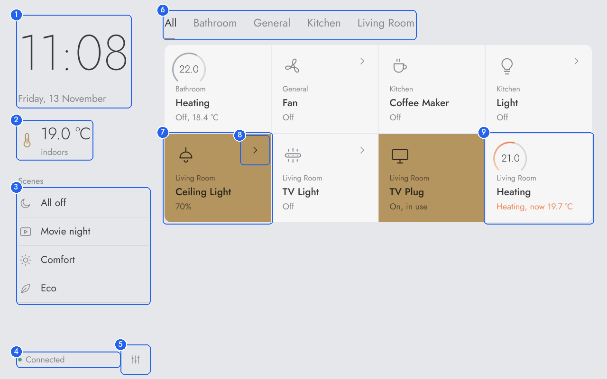

# Smart Home Panel

Touch app for the Raspberry Pi (Linux) to control lights, smart plugs and heating through
**Homebridge** using the **HomeKit Accessory Protocol (HAP)**. The UI is built with Qt Quick
(QML), the logic in Python with **PySide6**.



**[User interface guide with annotated screenshots for all screen sizes →](docs/user-interface.md)**

```
┌──────────────────────────── Raspberry Pi ────────────────────────────┐
│  Qt UI (QML)  ◄──── signals / properties ────┐                        │
│   home screen · detail views · settings       │                        │
│                                               │                        │
│  Controller (app/qt)  ──── background thread (asyncio) ────┐           │
│                             DeviceManager · Scheduler      │           │
│                             backends: HAP · Homebridge UI · demo       │
└────────────────────────────────────────────────────────────┼───────────┘
                                                             ▼
                                         Homebridge (HAP, port 51826 …)
```

## Features

- **Lights**: on/off, brightness bar, color wheel, white tone
- **Smart plugs / switches**: on/off, "in use" indicator
- **Heating**: thermostats and heater-coolers with a dial (drag or −/+), modes Off/Heat/Auto
- **Fans**: on/off, speed
- **Rooms, scenes, schedules** (e.g. weekdays 06:30 "Comfort", daily 22:30 "Eco")
- **Light / dark / automatic** appearance and a **screen saver** with a large clock
- **Settings page** for appearance, screen saver and the Homebridge connection (address, port, PIN)
  with keypad, connection test and apply without restart
- Optimized for **1280×800** and **720×720**; also works on 800×480, 1024×600, 1280×720 and portrait displays

## Requirements

- Raspberry Pi 4/5 (Pi 3 possible) with Raspberry Pi OS **Bookworm** or **Trixie**, 64-bit
- Homebridge **in insecure mode**: Homebridge UI → Settings → *Homebridge Insecure Mode*
  (same as `-I`), then restart Homebridge. Port and PIN are in Homebridge's `config.json`
  under `bridge`.

PySide6 is installed with pip: Bookworm automatically gets version 6.8, Trixie the current one.

## Installation

```bash
cd ~/homebridge-panel                 # clone the repository
./deploy/install.sh --autostart       # starts in full screen after login
```

| Command | Effect |
|---|---|
| `./deploy/install.sh` | install only, adds an application menu entry |
| `./deploy/install.sh --autostart` | also start in full screen at desktop login (labwc, wayfire, X11) |
| `./deploy/install.sh --eglfs` | full screen **without a desktop** as a system service (Pi OS Lite) |

For `--autostart`, enable desktop autologin: `sudo raspi-config` → *System Options* →
*Boot / Auto Login* → *Desktop Autologin*.

Then tap the settings icon at the bottom left, enter your Homebridge address, port and PIN,
tap **Test connection** and **Apply**.

### Starting manually

```bash
.venv/bin/python -m app                       # in a window (1024×600)
.venv/bin/python -m app --size 800x480        # different window size
.venv/bin/python -m app --fullscreen --hide-cursor
.venv/bin/python -m app --demo                # add simulated devices
```

## Settings

In the app (icon at the bottom left), stored in `~/.config/smarthome-panel/settings.json`:

| Section | Setting | Behavior |
|---|---|---|
| Display | Appearance: Automatic (dark 7 pm – 7 am), Light, Dark | saved immediately |
| Display | Screen saver after: never, 1, 2, 5, 15 minutes | saved immediately |
| Homebridge | Connect to Homebridge (on/off) | saved with **Apply** |
| Homebridge | Address (IP or host name), port, PIN | saved with **Apply**, try **Test connection** first |

Entries are validated (port 1–65535, PIN as 123-45-678, valid IP address or host name).
After **Apply** the app reconnects without restarting.

### Adding settings

The settings page is generated from a schema in `app/settings.py`:

1. Add an entry to `FIELDS`, e.g.
   `Field("poll_interval", "homebridge", "Polling interval", "choice", 5, options=((2, "2 s"), (5, "5 s"), (10, "10 s")))`.
   Kinds: `choice`, `toggle`, `number`, `host`, `pin`. For a new section add an entry to
   `SECTIONS` (`instant=True` saves immediately, `False` saves with "Apply").
2. Wire up the effect: if it affects the connection, evaluate it in `apply_to_config()`;
   if it affects the UI, expose it as a property in the `Controller` (`app/qt/controller.py`)
   and emit the matching signal in `settings_saved()`.

Validation and storage are handled by `validate()` and `SettingsStore`.

## Rooms, scenes, schedules (`config.yaml`)

| Section | Purpose |
|---|---|
| `server` | polling interval, time zone |
| `panel` | title, default room, `show_cooling` |
| `hap` | additional bridges (child bridges); the main bridge comes from the settings |
| `homebridge_ui` | alternatively access via the Homebridge web UI (username/password) |
| `demo` | simulated devices |
| `devices` | per device (ID or name): `room`, `name`, `icon`, `order`, `hidden` |
| `scenes` | scenes with actions `{device: …, set: {…}}` |
| `schedules` | run a scene at a time on weekdays (`mo tu we th fr sa su`) |

**Scene attributes**: `on`, `brightness` (0–100), `hue` (0–360), `saturation` (0–100),
`color_temp` (mired 140–500), `speed` (0–100), `target_temp` (°C), `mode` (`off|heat|cool|auto`).

**Icons** (`icon:`): `light`, `ceiling`, `strip`, `plug`, `switch`, `thermostat`, `radiator`,
`floor`, `fan`, `coffee`, `tv`; for scenes `moon`, `sun`, `film`, `leaf`, `home`, `power`.

See [docs/user-interface.md](docs/user-interface.md) for how each screen works.

## Project structure

```
app/
  __main__.py          entry point: python -m app
  settings.py          settings schema, validation, storage, effect on the configuration
  config.py            config.yaml (Pydantic)
  manager.py           device management: polling, commands, scenes
  scheduler.py         schedules
  hap_types.py         HAP types ⇄ device state/commands
  backends/            HAP, Homebridge UI, demo
  qt/
    main.py            Qt application, fonts, QML engine
    controller.py      bridge to QML: device model, settings, background thread
    format.py          tile texts
  qml/                 UI (Main.qml, theme, tiles, detail views, settings …)
  assets/fonts/        Jost (SIL Open Font License)
deploy/                install.sh, start.sh, systemd service for running without a desktop
docs/                  user interface guide and screenshots
tools/
  doc_screenshots.py   regenerates the annotated screenshots in docs/images
  screenshots.py       quick headless screenshots (also used as a QML load check)
tests/                 pytest: backends, manager, settings, Qt controller, QML
```

## Development

```bash
python3 -m venv .venv && . .venv/bin/activate
pip install -r requirements.txt pytest pillow
python -m pytest -q                     # includes headless Qt tests
python tools/doc_screenshots.py         # update the documentation screenshots
```

## Notes

- **Security**: in insecure mode anyone on your home network who knows the PIN can access Homebridge.
- **Native HomeKit devices without Homebridge** (e.g. Eve) need encrypted HAP pairing, which is not
  included. Add such devices to Homebridge with a plugin instead.
- Changes made elsewhere (e.g. in the Home app) appear within 5 seconds; your own commands immediately.
- On the Pi, Qt draws lines and arcs with its GPU curve renderer. On very old models without
  OpenGL ES 3, set `QT_QUICK_BACKEND=software`.
- Schedules also accept the German weekday abbreviations (`di mi do so`) for older configurations.
